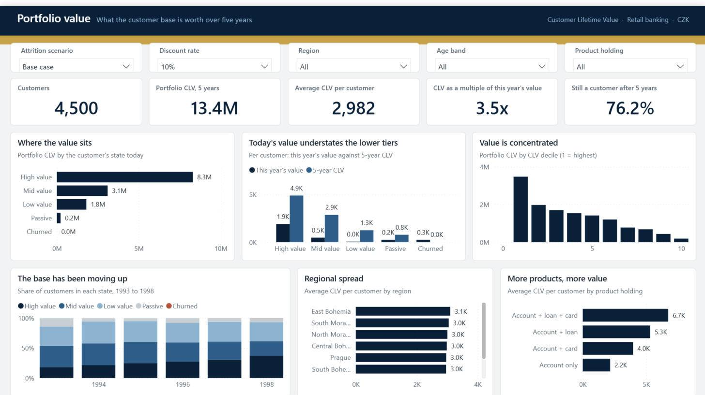
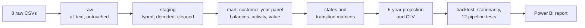
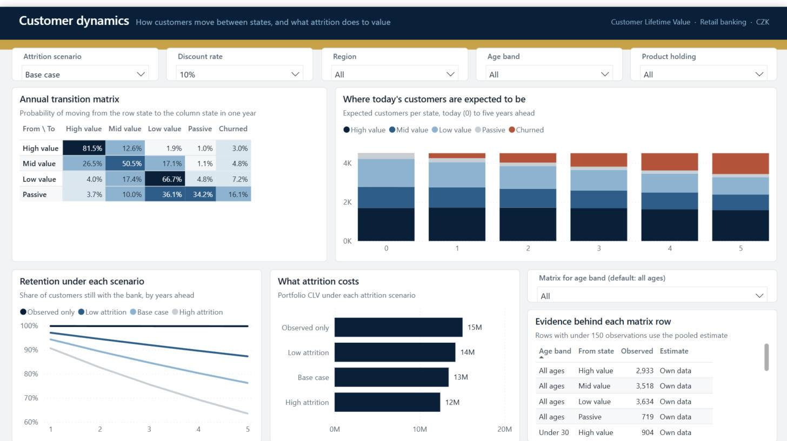
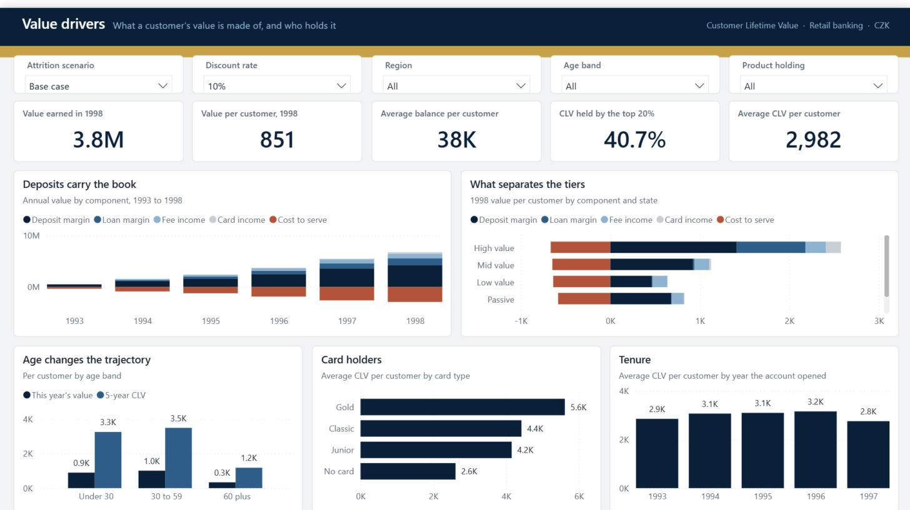
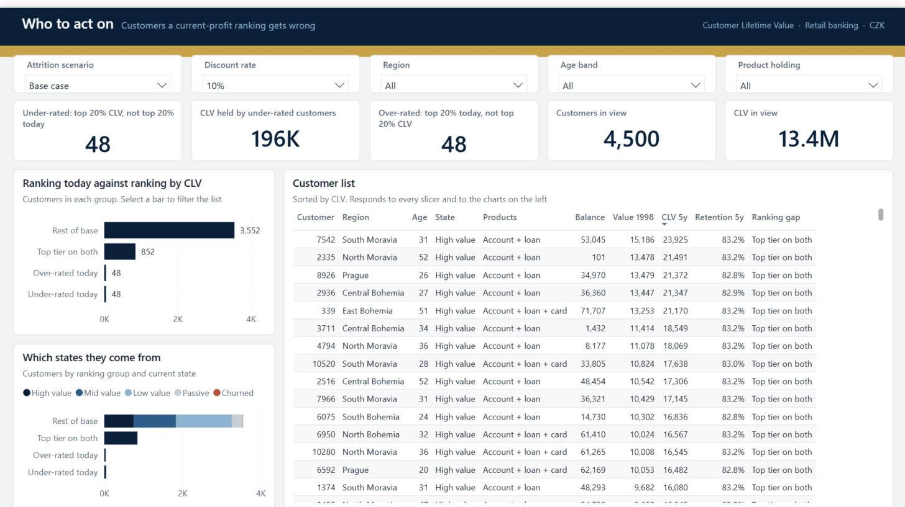
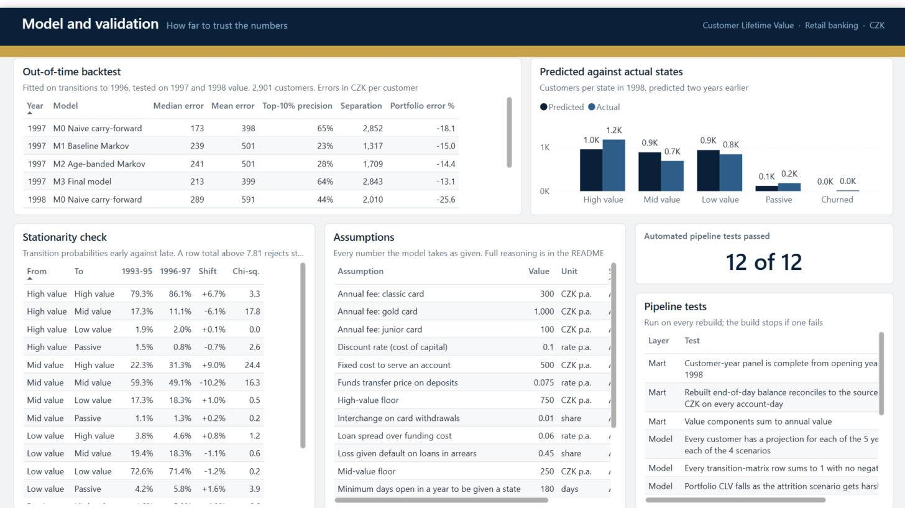

# Customer Lifetime Value in Retail Banking

A five-year customer lifetime value (CLV) model for a retail bank, built end to end: raw transactions to a tested PostgreSQL warehouse, a Markov-chain projection written in SQL, an out-of-time backtest, and a five-page Power BI report.

**Stack:** PostgreSQL 16 · SQL (window functions, PL/pgSQL) · Power BI (Power Query, DAX, PBIP project format)

**Data:** the PKDD'99 "Berka" dataset. Real, anonymised data from a Czech bank, 1993 to 1998: 4,500 accounts, 5,369 clients, 1,056,320 transactions, 682 loans, 892 cards.



## The question

A bank ranks customers by what they earned it this year. That ranking ignores where customers are heading: some low earners are on their way up, some high earners will not stay. CLV values the relationship over the next five years instead of the last one.

## Headline results

Base case (6% base annual attrition), 10% discount rate, values in CZK.

| | |
|---|---|
| Customers | 4,500 |
| Portfolio CLV, 5 years | 13.4M |
| Average CLV per customer | 2,982 |
| Value earned in 1998 | 3.8M |
| CLV as a multiple of 1998 value | 3.5x |
| Customers retained after 5 years | 76% |

**Current profit overstates how concentrated the base is.** The top 20% of customers hold 64% of this year's value but 41% of five-year CLV.

**The Low-value tier is not worth nothing.** Its 1,431 customers earned the bank about 2 CZK each in 1998, yet carry an average CLV of 1,257 CZK and 13% of portfolio CLV. In a typical year 19% of them move up to Mid value and 4% to High value.

| State in 1998 | Customers | Value 1998 (avg) | CLV (avg) | Share of CLV |
|---|---:|---:|---:|---:|
| High value | 1,693 | 1,911 | 4,902 | 62% |
| Mid value | 1,080 | 478 | 2,869 | 23% |
| Low value | 1,431 | 2 | 1,257 | 13% |
| Passive | 288 | 247 | 781 | 2% |

**Attrition is the biggest unknown.** Portfolio CLV runs from 15.1M with no attrition to 12.4M at 10% base attrition. The dataset cannot settle which is right (see Limitations).

## How it works



### 1. Value per customer per year

Berka has no profit figures, so annual value is built from five components. Observed postings are used wherever they exist; the rest are explicit assumptions held in one table (`mart.assumption`).

| Component | How it is measured |
|---|---|
| Deposit margin | Time-weighted average daily balance x 7.5% funds transfer price, minus the interest the bank actually paid (observed, about 4.9%) |
| Loan margin | Scheduled principal outstanding x (6.0% spread - 3.2% expected loss). The loss rate is calibrated from the defaults in the data |
| Fee income | Statement fees and penalty interest, as posted |
| Card income | Assumed annual fee by card type, plus 1% interchange on observed card volume |
| Cost to serve | 500 CZK per account per year, plus 3 CZK per customer transaction |

### 2. States

Each customer-year is given one of five states. Thresholds are fixed CZK amounts, not per-year quantiles, so drift in the base stays visible.

| State | Rule |
|---|---|
| High value | Annualised value of 750 CZK or more |
| Mid value | 250 up to 750 CZK |
| Low value | Below 250 CZK, including loss-making |
| Passive | Fewer than one discretionary transaction a month |
| Churned | Relationship ended (absorbing) |

### 3. Transition matrices

A first-order Markov chain with annual periods. P(i to j) is the share of customers in state i one year who are in state j the next, estimated from 10,804 observed transitions.

| From \ To | High | Mid | Low | Passive |
|---|---:|---:|---:|---:|
| High value | 84.0% | 13.0% | 2.0% | 1.0% |
| Mid value | 27.8% | 53.1% | 17.9% | 1.2% |
| Low value | 4.3% | 18.7% | 71.8% | 5.2% |
| Passive | 4.3% | 11.8% | 42.4% | 40.2% |

Matrices are estimated separately for three age bands (under 30, 30 to 59, 60 plus), and a customer moves onto the next band's matrix as they age through the projection. The 60-plus matrix is materially different: a Low-value customer aged 60 or over has an 18.5% chance of turning Passive, against 5.2% overall. Any matrix row with fewer than 150 observations falls back to the pooled estimate.

The matrix above is observed movement only. The report shows it after the selected attrition scenario is applied, so its figures are slightly lower and include a Churned column.

### 4. Projection and CLV

```
state probabilities   p(k) = p(k-1) x P
expected value        EV(k) = sum over states of p(k, state) x mean value of state
                              + rho^k x (customer's own gap to their state mean) x survival(k)
CLV                   sum of EV(k) / (1 + r)^k   for k = 1..5
```

The second term is what makes CLV customer-specific. Without it every High-value customer would get the same number. `rho` is the share of a customer's gap to their state average that survives a year. It is estimated from the data at 0.69.

### 5. Attrition scenarios

Berka is a sample of surviving accounts. Of 4,500 accounts, 4,480 are still posting in the last two months of the data, and only 9 ever go silent for a full calendar year. An observed closure rate near 0.1% a year is not a credible input to a lifetime-value model, and redefining churn does not fix it, because the leavers are not in the data.

Attrition is therefore an explicit, labelled scenario, not an estimate: 0%, 3%, 6% (base) or 10% a year, scaled by state so that Passive customers leave at 2.5 times the base rate and High-value customers at half of it.

## Validation

**Out-of-time backtest.** Everything is refitted on transitions that start in 1995 or earlier. Customers start from their 1996 state, and the model predicts their 1997 and 1998 value. 2,901 customers.

| Model | Horizon | Median error | Mean error | Top-10% precision | Portfolio error |
|---|---|---:|---:|---:|---:|
| Naive (next year = this year) | 1 year | 173 | 398 | 65% | -18.1% |
| Baseline Markov, state means | 1 year | 239 | 501 | 23% | -15.0% |
| Age-banded Markov | 1 year | 241 | 501 | 28% | -14.4% |
| **Final model** | 1 year | 213 | 399 | 64% | -13.1% |
| Naive | 2 years | 289 | 591 | 44% | -25.6% |
| Baseline Markov, state means | 2 years | 329 | 575 | 23% | -19.4% |
| Age-banded Markov | 2 years | 332 | 574 | 23% | -18.4% |
| **Final model** | 2 years | 332 | 549 | 44% | -17.6% |

Reading the table:

- **One year ahead, the final model is no better than assuming nothing changes.** Customer value is persistent, and a naive carry-forward is a strong benchmark.
- **Two years ahead the model pulls in front** on mean error (549 against 591) and on the portfolio total (-17.6% against -25.6%). Its advantage grows with the horizon, which is the case for using it on a five-year question.
- **State-mean models cannot rank customers.** Every customer in a state gets the same prediction, so top-decile precision is close to arbitrary. The persistence term fixes this.
- **Age bands add little accuracy.** They are kept because the 60-plus matrix is visibly different, not because the backtest rewards them.
- **Every model under-predicts.** Customers moved up faster in 1996 to 1998 than in the years the model was fitted on. The projection is conservative.

**Stationarity.** A Markov projection assumes future transition probabilities look like past ones. Comparing transitions that start in 1993 to 1995 with those that start in 1996 to 1997, the assumption is rejected at 5% for three of the four origin states. The largest shifts: Mid to High rose from 22% to 31%, and Passive to Low fell from 52% to 38%. The matrix is a snapshot of a bank whose customers were getting more valuable, and it should be re-estimated every year.

**Pipeline tests.** `sql/08_tests.sql` runs 12 assertions on every rebuild and stops the build if one fails. They cover row counts against the published dataset figures, key uniqueness, balance reconciliation to the source on all 814,768 account-days, panel completeness, and the internal consistency of the matrices and projections.

## Limitations

- **Attrition is assumed, not measured.** See above. This is the single largest source of uncertainty in the portfolio figure.
- **Value levels depend on assumptions.** The funds transfer price, loan spread and cost figures set the level of every CZK number. Rankings, transitions and the shape of the results come from the data. Change the assumptions in `mart.assumption` and rebuild to see the effect.
- **Loan revenue is modelled.** The loan table stores principal only: payments x duration equals the amount for all 682 loans, so interest income is not observable.
- **The five-year horizon is not validated.** With six years of data the backtest reaches two years. Cowan et al. (2023) report the same constraint.
- **The data is from the 1990s.** The method carries over to a modern bank; the numbers do not.

## Run it

Requires PostgreSQL 14 or later and Power BI Desktop. Put the source files in `data/raw/` first (see `data/raw/README.md`).

To look at the report without rebuilding anything, open `powerbi/CLV Banking.pbix`.

```
createdb clv_banking
psql -d clv_banking -v ON_ERROR_STOP=1 -f sql/run_all.sql
```

Run from the project root. It takes about a minute and rewrites `data/mart/*.csv`.

Then open `powerbi/CLV Banking.pbip` in Power BI Desktop and select **Refresh**. If the project is not in `C:\Users\USER\Documents\Projects\clv-banking`, change the `ProjectFolder` parameter first (Transform data, then Edit parameters).

## Repository

```
sql/
  00_schemas.sql              raw, staging, mart
  01_create_raw.sql           8 raw tables, all text
  02_load_raw.sql             row-count verification
  03_staging.sql              typing, date parsing, Czech codes to English
  04_mart_customer_year.sql   assumptions, daily balances, customer-year panel and value
  05_mart_states.sql          states, transitions, matrices, attrition scenarios
  06_mart_clv.sql             projection functions, CLV, customer dimension
  07_validation.sql           out-of-time backtest and stationarity check
  08_tests.sql                12 pipeline assertions
  09_export.sql               reporting views and CSV export
  run_all.sql                 one-command rebuild
data/
  raw/                        the 8 source files (not committed)
  mart/                       reporting tables read by Power BI
powerbi/
  CLV Banking.pbix            single-file report with data, opens directly
  CLV Banking.pbip            project format, open this to edit
  CLV Banking.SemanticModel/  model, relationships, 27 DAX measures (TMDL)
  CLV Banking.Report/         5 pages (PBIR)
  Vault.theme.json            report theme
```

## The report

| Page | What it answers |
|---|---|
| Portfolio value | What is the base worth, and where does the value sit? |
| Customer dynamics | How do customers move between states, and what does attrition cost? |
| Value drivers | What is a customer's value made of, and who holds it? |
| Who to act on | Which customers does a current-profit ranking get wrong? |
| Model and validation | How far should these numbers be trusted? |

The attrition scenario and the discount rate (4% to 16%) are slicers. CLV is discounted in DAX, so changing the rate needs no rebuild.

### Other pages (the first is at the top)

**Customer dynamics**



**Value drivers**



**Who to act on**



**Model and validation**



## References

- Cowan, G., Mercuri, S. and Khraishi, R. (2023). *Modelling customer lifetime-value in the retail banking industry.* arXiv:2304.03038. Source of the value definition, the five-year horizon, the first-order Markov baseline and the evaluation metrics.
- ABN AMRO (2023). *Customer Lifetime Value in Banking.* ABN AMRO Developer Blog. Source of the age-specific transition matrices, the small-sample fallback and the stationarity check.
- Haenlein, M., Kaplan, A. and Beeser, A. (2007). A model to determine customer lifetime value in a retail banking context. *European Management Journal*, 25(3).
- Pfeifer, P. and Carraway, R. (2000). Modeling customer relationships as Markov chains. *Journal of Interactive Marketing*, 14(2).
- Berka, P. and Sochorova, M. (1999). *PKDD'99 Discovery Challenge: Guide to the Financial Data Set.*
